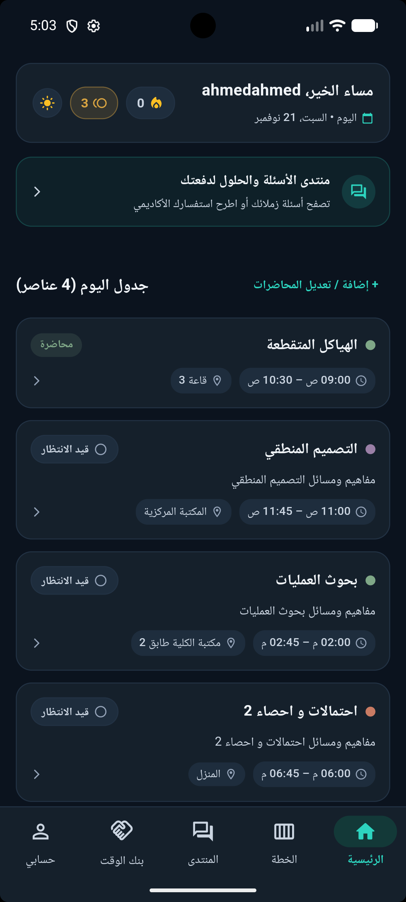
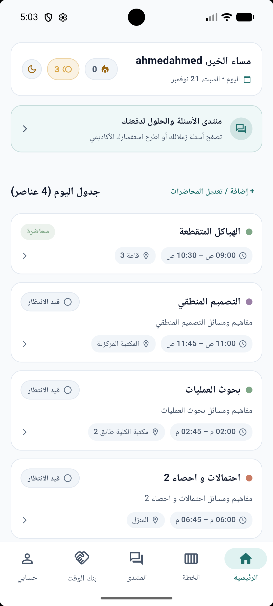
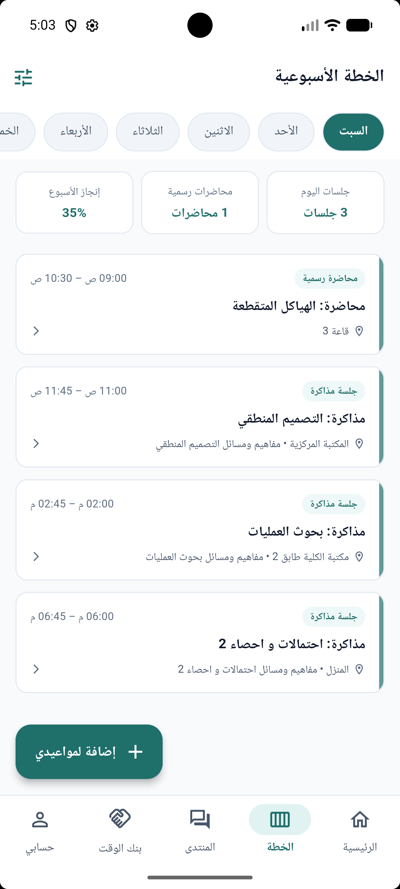
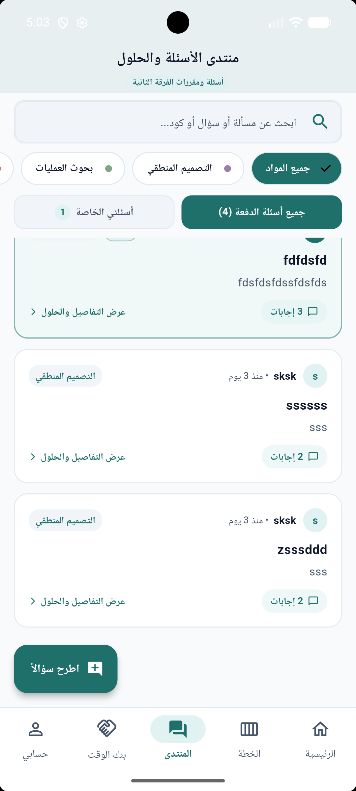
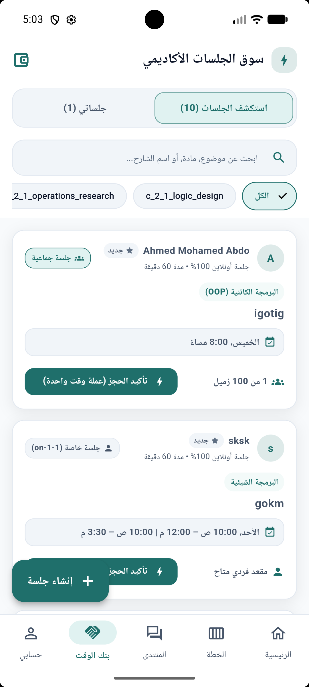
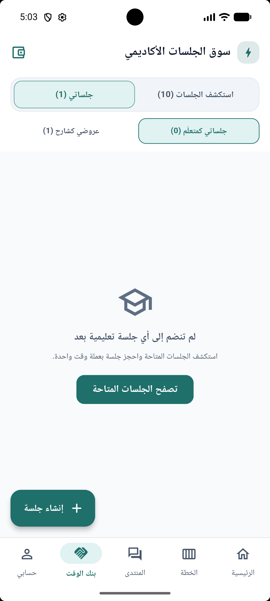
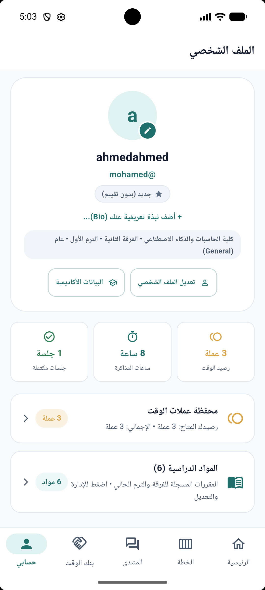

<div align="center">

<p align="center">
  
</p>

# زميل | Zameel
### منصة التعلّم التشاركي والتخطيط الأكاديمي الذكي  
**Smart Academic Planner & Peer Learning TimeBank**

تطبيق جامعي متكامل لطلاب كليات الحاسبات والذكاء الاصطناعي، يجمع بين جدولة المذاكرة الذكية وموازنة الحمل الإدراكي، وجلسات الشرح التبادلي العادلة بنظام **بنك الوقت (TimeBank)** ونظام **الضمان الأكاديمي (Escrow)**، ومنتدى الأسئلة والحلول المتخصص.  
مبني بـ **Flutter** وفق معمارية **Clean Architecture** وإدارة الحالة بـ **Riverpod**، مع دعم كامل للغة العربية (RTL) ونظام **Material 3**.

<br>

<p align="center">
  <a href="https://flutter.dev">
    
  </a>
  <a href="https://dart.dev">
    
  </a>
  <a href="https://riverpod.dev">
    
  </a>
  <a href="https://firebase.google.com">
    
  </a>
  <a href="#-التقنيات-والبنية-البرمجية">
    
  </a>
  <a href="#-نظام-التصميم-والهوية-البصرية">
    
  </a>
  <a href="#-الترخيص">
    
  </a>
</p>

</div>

---

## نظرة عامة سريعة

| المحور | المواصفات والتفاصيل التقنية |
| :--- | :--- |
| **الجمهور المستهدف** | طلاب كلية الحاسبات والذكاء الاصطناعي (مقررات الفرق الدراسية ومسارات التخصص) |
| **المعمارية البرمجية** | Clean Architecture (Domain, Data, Presentation) مقسمة بنمط Feature-first |
| **إدارة الحالة** | Flutter Riverpod (StateNotifier, FutureProvider, StreamProvider) |
| **قاعدة البيانات والسيرفر** | Cloud Firestore مع 644 سطراً من قواعد الحماية الصارمة (Atomic Escrow Rules) |
| **محرك الاقتصاد والتبادل** | بنك الوقت الأكاديمي (ساعة شرح = 1 عملة وقت) ونظام الضمان المحاسبي غير القابل للتلاعب |
| **محرك الجدولة** | خوارزمية ذكية لموازنة الحمل الإدراكي (Cognitive Load Balancing) ومنع تعارض المواعيد |
| **التحقق والاختبارات** | 80 اختباراً برمجياً ناجحاً 100% يشمل الـ Logic وقواعد الحماية وفحوصات الـ UI Guards |

---

## نبذة عن المشروع

تطبيق **«زميل»** هو منصة تعاونية هندسية تسعى لإعادة صياغة تجربة التعلّم الجامعي لطلاب علوم الحاسب؛ حيث ينطلق المشروع من مبدأ:  
> **«ذاكر بخطة، وعلّم زميلك، وتعلّم من غيرك»**

في الأوساط الجامعية، يواجه الطلاب تحديين أساسيين:
1. **تشتت خطة المذاكرة** وصعوبة التوفيق بين المحاضرات الرسمية المكثفة وساعات الاستذكار الذاتي وتوزيع المواد الصعبة دون إجهاد ذهني.
2. **فجوة الفهم والاستفسارات الأكاديمية**، في ظل انتشار الدروس الخصوصية التجارية أو تردد الطلاب في طلب المساعدة؛ لذا يبتكر التطبيق **نظام بنك الوقت الأكاديمي (TimeBank)**: وهو نموذج تعاوني تكافلي يتيح للطالب المتميز في مادة ما شرحها لزملائه واكتساب "عملات وقت"، ثم استخدام تلك العملات للحصول على جلسات شرح في المواد التي يواجه فيها صعوبة، تحت مظلة نظام ضمان عادل (Escrow) يحفظ حق الطرفين دون أي تعاملات نقدية.

<br>

### About The Project (English)

**Zameel** is a comprehensive peer-learning platform and intelligent study planner engineered specifically for Computer Science & Artificial Intelligence undergraduates.  
The platform synthesizes two powerful concepts:
1. **Intelligent Cognitive Load Scheduling**: An automated academic planner that digests lecture timetables, mitigates subject conflicts, balances daily cognitive difficulty, tracks study streaks with weekend immunity, and embeds a focused Pomodoro timer with Do-Not-Disturb (DND) automation.
2. **TimeBank Knowledge Exchange & Atomic Escrow**: A fair, non-monetary 1:1 academic economy where 1 hour of peer teaching yields 1 TimeCoin, backed by an immutable Firestore-enforced atomic escrow protocol that prevents double-booking, guarantees refund on cancellations, and secures rewards upon session delivery.

---

## لقطات الشاشة / App Screenshots

<div align="center">
  <table>
    <tr>
      <th align="center">الرئيسية (الوضع الداكن)</th>
      <th align="center">الرئيسية (الوضع الفاتح)</th>
      <th align="center">الخطة الأسبوعية</th>
      <th align="center">منتدى الأسئلة والحلول</th>
    </tr>
    <tr>
      <td align="center"></td>
      <td align="center"></td>
      <td align="center"></td>
      <td align="center"></td>
    </tr>
    <tr>
      <th align="center">سوق الجلسات الأكاديمي</th>
      <th align="center">جلساتي ونظام الضمان</th>
      <th align="center">الملف الشخصي والمحفظة</th>
      <th align="center">شعار وهوية زميل</th>
    </tr>
    <tr>
      <td align="center"></td>
      <td align="center"></td>
      <td align="center"></td>
      <td align="center"></td>
    </tr>
  </table>
</div>

---

## المميزات الجوهرية بالتفصيل

### ١. محرك الجدولة والخطة الأسبوعية الذكية (Smart Academic Planner)
* **موازنة الحمل الإدراكي (Cognitive Load Balancing):** توزيع فترات المذاكرة الذاتية أوتوماتيكياً حول المحاضرات الثابتة، وتجنب جدولة مادتين ذات صعوبة عالية في نفس اليوم الدراسي.
* **محرك منع التعارض والتكرار (Deduplication Engine):** فحص حتمي لمنع إضافة نفس المقرر أكثر من مرة أسبوعياً وحظر التداخل الزمني بين القاعات والمواعيد.
* **مؤقت بومودورو للتركيز الموجه (Pomodoro Focus Timer):** جلسات تركيز موجهة (25 دقيقة / 50 دقيقة) مع تكامل مباشر مع وضع عدم الإزعاج (DND Mode) بالهاتف لضمان استقرار جلسة المذاكرة.
* **احتساب الستريك اليومي (Daily Study Streak):** حساب دقيق لتتابع أيام المذاكرة اليومية مع نظام حصانة عطلة نهاية الأسبوع (Weekend Immunity) لضمان عدم انكسار الستريك في أيام الراحة.

### ٢. بنك الوقت وسوق الجلسات التشاركي (TimeBank Peer Learning)
* **اقتصاد المعرفة التبادلي (1:1 Reciprocity):** كل ساعة شرح يقدمها الطالب لزملائه تكسبه عملة وقت واحدة، تمكّنه من حجز ساعة شرح في مادة أخرى يحتاج فيها لتعزيز فهمه.
* **دعم الجلسات الفردية والجماعية:** إمكانية طرح جلسات استفسار فردية (1-on-1) أو جلسات مراجعة جماعية تسع حتى 100 زميل.
* **نظام الضمان الأكاديمي الذري (Atomic Escrow Protocol):**
  * عند حجز الجلسة: تُحجز العملة فوراً في حالة الضمان (`held`) ويُسجل قفل الموعد (`slotLocks`).
  * عند إتمام الجلسة وتأكيد المتعلّم: تُحرر العملة لحساب المعلم (`released_to_teacher`) مع تسجيل التقييم الأكاديمي.
  * عند اعتذار المعلم أو الإلغاء المبكر: تُسترد العملة تلقائياً لمحفظة المتعلّم (`refunded_to_learner`).
  * عند الإلغاء المتأخر قبل الموعد بأقل من ساعتين: يتم تعويض المعلم بالعملة لحفظ وقته.
* **محادثة فورية مشفرة للجلسة (Session Chat):** محادثة داخلية مخصصة حصرياً لأطراف الجلسة لتنسيق الاستفسارات ومشاركة روابط الاجتماعات الافتراضية (Google Meet / Zoom).

### ٣. منتدى الأسئلة والحلول الأكاديمي (Academic Q&A Forum)
* **تصنيف دقيق حسب الفرق والمواد:** تصفية فورية لأسئلة المقررات (مثل: التصميم المنطقي، بحوث العمليات، هياكل البيانات، الاحتمالات والإحصاء).
* **اعتماد الحل النموذجي (Accepted Solution):** إمكانية تمييز أفضل إجابة وتحديدها كحل معتمد من قِبل صاحب السؤال لمساعدة باقي الدفعة.
* **محرك بحث فوري يدعم اللغة العربية:** معالجة الهمزات والتطبيع الصرفي لمنع فقدان أي سؤال أثناء البحث.

### ٤. محفظة الوقت ودفتر الأستاذ غير القابل للتعديل (Immutable Ledger)
* **دفتر حسابات مالي تاريخي (`transactions`):** كل حركة خصم، إيداع، تحرير، أو تعويض يتم توثيقها كقيد محاسبي غير قابل للتعديل أو الحذف من أي طرف.
* **عرض شفاف للرصيد المتاح والرصيد المعلق:** بطاقة محفظة مصممة بأسلوب هادئ ومريح للعين تبرز الرصيد الجاهز للحجز والرصيد المحتجز قيد تنفيذ الجلسات.

### ٥. نظام التصميم الشامل والهوية البصرية (Design System & Theme Tokens)
* **شعار هندسي أصيل:** رمز «ز» متقاطع يعبر عن تدفق وتبادل المعرفة كودياً عبر `CustomPainter` ورسم متجه `SVG`.
* **مطابقة معايير النفاذ العالمية (WCAG AA Compliant):** جميع درجات النصوص والأزرار تحقق نسبة تباين تفوق $4.5:1$ على خلفيات السطح الداكن والفاتح.
* **خلو تام من الإيموجي في الواجهات الثابتة:** استبدال الرموز التعبيرية بأيقونات Material مدورة ومنضبطة ذات أحجام وهندسة متناسقة.
* **طباعة عربية رسمية:** اعتماد خط `IBM Plex Sans Arabic` حصرياً مع مراعاة كاملة لانسيابية القراءة من اليمين لليسار (RTL).

---

## التقنيات والبنية البرمجية

```
├── Framework:            Flutter (Material 3 Enabled)
├── Language:             Dart 3.x (Sound Null Safety)
├── State Management:     Flutter Riverpod
├── Navigation:           GoRouter (Declarative Routing with Auth & Onboarding Guards)
├── Backend & Database:   Firebase Cloud Firestore (Atomic Transactions & Strict Rules)
├── Authentication:       Firebase Auth (Email/Password with Verification)
├── Local Storage:        SharedPreferences (Theme & Local Caches)
├── Hardware Integration: System DND Focus Services & Local Notifications
├── Typography:           IBM Plex Sans Arabic (Dedicated Arabic Font)
└── Architecture Pattern: Clean Architecture (Domain, Data, Presentation per Feature)
```

---

## هيكل المجلدات البرمجية (Project Architecture)

```
zameel/
├── assets/
│   ├── brand/                      # الشعار الهندسي، أيقونات التطبيق، ورسمة الـ SVG
│   └── fonts/                      # خط IBM Plex Sans Arabic المعتمد
├── docs/
│   └── BRANDING.md                 # دليل الهوية البصرية ومواصفات الألوان المعتمدة
├── firestore.rules                 # قواعد أمان السيرفر ونظام الضمان المالي الصارم (644 سطر)
├── lib/
│   ├── core/
│   │   ├── algorithms/             # خوارزميات موازنة الحمل والجدولة الأكاديمية
│   │   ├── constants/              # ثوابت المقررات، الفرق الدراسية، ومعايير الكلية
│   │   ├── models/                 # نماذج البيانات (User, Offer, Session, Schedule)
│   │   ├── routing/                # إعدادات GoRouter مع حراسة المصادقة والتهيئة
│   │   ├── services/               # خدمات الإشعارات، ووضع عدم الإزعاج (DND)
│   │   ├── theme/                  # نظام الرموز الدلالية (AppTokens) وثيمات M3
│   │   └── widgets/                # المكونات المشتركة (ZameelLogo, StatusBadge, IconLabel)
│   ├── features/
│   │   ├── auth/                   # شاشات الترحيب، الدخول، والتسجيل، وتأكيد البريد
│   │   ├── home/                   # هيكل التنقل السفلي الموحد (MainNavigationShell)
│   │   ├── onboarding/             # شاشات تهيئة الدفعة والمقررات واختيار المواد
│   │   ├── planner/                # جدول اليوم، الخطة الأسبوعية، ومؤقت بومودورو
│   │   ├── profile/                # الملف الشخصي للطالب، إدارة المواد، والإعدادات
│   │   ├── questions/              # منتدى الأسئلة والحلول، نشر الأسئلة والردود
│   │   ├── sessions/               # تفاصيل الجلسات، التقييم، ومحادثة التنسيق
│   │   ├── timebank/               # سوق الجلسات، حجز المواعيد، وإنشاء عروض الشرح
│   │   └── wallet/                 # محفظة عملات الوقت وسجل المعاملات
│   └── main.dart                   # نقطة انطلاق التطبيق وتهيئة بيئة التشغيل
└── test/
    ├── curriculum_mapping_test.dart# اختبارات مطابقة المقررات والفرق الدراسية
    ├── design_guard_test.dart      # اختبارات حماية نظام التصميم الـ 7 وتباين WCAG AA
    └── escrow_rules_test.dart      # اختبارات نظام الضمان والتحولات المحاسبية (Pure Logic)
```

---

## جودة الكود واختبارات الحماية (Testing & Quality Assurance)

يخضع المشروع لمنظومة اختبارات أوتوماتيكية صارمة تضمن استقرار المنظومة وخلوها من الأخطاء:

```bash
$ flutter test
00:02 +80: All tests passed!
```

### حزم الاختبارات المعتمدة:
1. **اختبارات حماية نظام التصميم (Design System Guards):**
   * خلو تام من أي رمز تعبيري (Emoji) في النصوص الثابتة عبر فحص AST أوتوماتيكي.
   * فحص تباين الألوان وفق معيار WCAG AA بنسبة تباين تفوق $4.5:1$ للوضع الداكن والفاتح.
   * حظر استخدام الألوان السداسية الصريحة `Color(0x...)` خارج مجلد الثيم.
   * حظر الشفافية المهملة `withOpacity` وفرض دالة `withValues(alpha: ...)`.
   * توحيد أنصاف الأقطار عبر `AppRadii` وحظر القيم الرقمية العشوائية.
2. **اختبارات نظام الضمان والمحفظة (Escrow & TimeBank Tests):**
   * التحقق الذري من شروط الخصم والتحرير والاسترداد ومنع الرصيد السالب.
   * التحقق من سلامة قيود دفتر الأستاذ المحاسبي ومنع التكرار أو التعديل.
3. **اختبارات خريطة المقررات (Curriculum & Academic Mapping):**
   * مطابقة جميع مقررات كلية الحاسبات والذكاء الاصطناعي على مدار الـ 8 فصول دراسية.

---

## كيفية التثبيت والتشغيل المحلي

### المتطلبات الأساسية
* تثبيت [Flutter SDK](https://flutter.dev/docs/get-started/install) بإصدار `^3.13.0` أو أحدث.
* تثبيت [Git](https://git-scm.com).
* حساب Firebase مهيأ لمشروعك (مع تفعيل Authentication و Cloud Firestore).

### خطوات التشغيل
1. **استنساخ المستودع:**
   ```bash
   git clone https://github.com/a7mdabdoo/zameel.git
   cd zameel
   ```

2. **تثبيت الحزم والتبعيات:**
   ```bash
   flutter pub get
   ```

3. **تشغيل حزمة الاختبارات للتأكد من سلامة البيئة:**
   ```bash
   flutter test
   ```

4. **تشغيل الفحص والتحليل الساكن:**
   ```bash
   flutter analyze
   ```

5. **بدء تشغيل التطبيق على المحاكي أو الجهاز الحقيقي:**
   ```bash
   flutter run
   ```

---

## المطور والتواصل (Developer & Connect)

تم تطوير وتصميم منصة **«زميل»** بشغف واهتمام بأدق التفاصيل الهندسية لتوفير منصة تعليمية وتشاركية رصينة للطلاب الجامعيين:

* **المطور:** أحمد محمد عبده (Ahmed Mohamed Abdo)
* **التخصص:** طالب علوم الحاسب والذكاء الاصطناعي، شغوف بهندسة النظم وحلول التكنولوجيا التعليمية (EdTech) وتطوير تطبيقات Flutter المتقدمة.
* **البريد الإلكتروني:** [ahmed@mohamed-abdo.me](mailto:ahmed@mohamed-abdo.me)
* **حساب GitHub:** [github.com/a7mdabdoo](https://github.com/a7mdabdoo)

---

## الترخيص (License)

هذا المشروع منشور تحت مظلة رخصة **MIT License** — للاطلاع على التفاصيل الكاملة، يُرجى مراجعة ملف [LICENSE](LICENSE).
